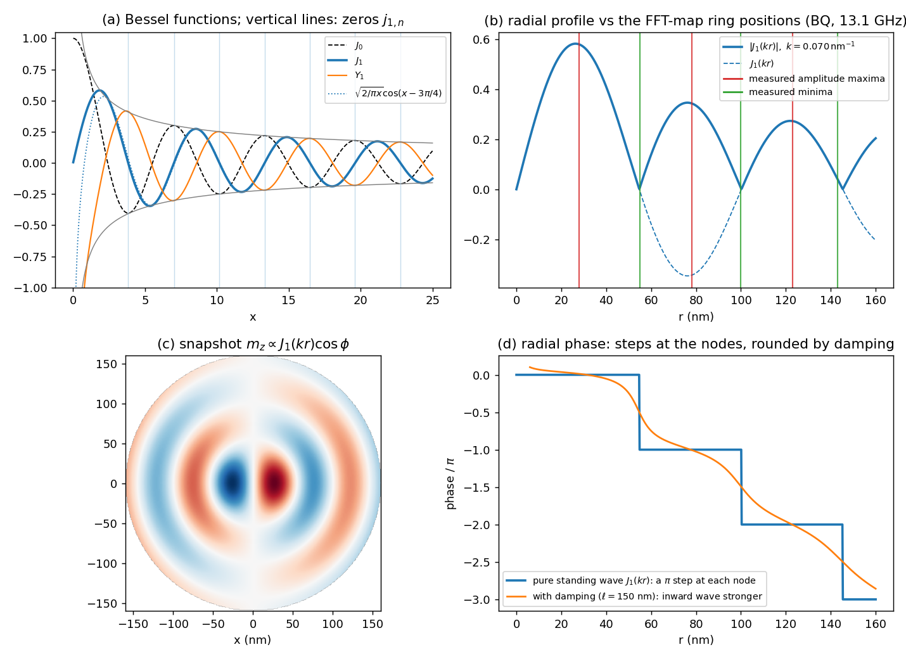

# Crash course: Bessel functions, as used in Sections 6 and 7

Short version: **Bessel functions are the sines and cosines of circular geometry.** Whenever you solve a wave equation at one frequency in polar coordinates, the radial part comes out as a Bessel function for exactly the same reason that in Cartesian coordinates it comes out as $\sin kx$ and $\cos kx$. Everything you know about standing waves on a string carries over, with three modifications: the amplitude envelope falls as $1/\sqrt r$, the zeros are not quite evenly spaced near the centre, and the centre itself imposes a boundary condition. The figure `bessel_primer.png` goes with this note.

## 1. Where they come from: separation of variables

A wave at a single frequency obeys the Helmholtz equation $(\nabla^2+k^2)\,u=0$. In Cartesian coordinates $u=e^{\mathrm ikx}$ solves it; done. In polar coordinates the Laplacian is

$$
\nabla^2=\frac{\partial^2}{\partial r^2}+\frac1r\frac{\partial}{\partial r}+\frac1{r^2}\frac{\partial^2}{\partial\phi^2}.
$$

Try a product $u=f(r)\,e^{\mathrm im\phi}$ with integer $m$ (so that $u$ is single-valued around the circle). The $\phi$ derivative gives $-m^2/r^2$, and what is left is an ordinary differential equation for $f$:

$$
f''+\frac1rf'+\Big(k^2-\frac{m^2}{r^2}\Big)f=0 .
$$

Substitute $x=kr$ and this becomes **Bessel's equation of order $m$**,

$$
\frac{d^2f}{dx^2}+\frac1x\frac{df}{dx}+\Big(1-\frac{m^2}{x^2}\Big)f=0 .
$$

Compare with the string: $f''+k^2f=0$. The two extra terms are what the circle adds. $f'/r$ comes from the circumference growing with $r$ (geometric spreading); $-m^2/r^2$ is the centrifugal term of a wave carrying $m$ units of angular momentum about the centre. Neither has any free parameter, which is why the solutions are universal functions with tables.

For this problem $m=1$ was fixed by the drive (Section 6), so only order 1 is needed; $J_0$ appears below only for comparison.

## 2. The two solutions and what they look like

A second-order equation has two independent solutions. For order $m$ they are called $J_m(x)$ and $Y_m(x)$ (panel a). What matters in practice:

**Near the centre** ($x\ll1$):

$$
J_m(x)\simeq\frac{1}{m!}\Big(\frac x2\Big)^m,\qquad Y_m(x)\simeq-\frac{(m-1)!}{\pi}\Big(\frac2x\Big)^m\ (m\ge1).
$$

So $J_1(x)\simeq x/2$ vanishes linearly at the origin, and $Y_1\simeq-2/(\pi x)$ blows up. In a disk the centre is an ordinary piece of film, nothing singular can happen there, so $Y_1$ is thrown out. **That one sentence is the entire role of "regularity at $r=0$".** $J_1(0)=0$ also tells you the pattern must have zero amplitude at the centre, which is what an $m=1$ pattern needs anyway: a quantity $\propto e^{\mathrm i\phi}$ cannot have a well-defined value at the point where $\phi$ is undefined.

**Far from the centre** ($x\gg m$), the asymptotic forms

$$
J_m(x)\simeq\sqrt{\frac{2}{\pi x}}\cos\Big(x-\frac{m\pi}2-\frac\pi4\Big),\qquad
Y_m(x)\simeq\sqrt{\frac{2}{\pi x}}\sin\Big(x-\frac{m\pi}2-\frac\pi4\Big),
$$

say that a Bessel function is just a cosine (or sine) of $kr$, with a fixed phase offset and an amplitude falling as $1/\sqrt{x}$. The dotted curve in panel (a) is this approximation for $J_1$; it is already excellent beyond $x\approx3$. The $1/\sqrt r$ envelope is energy conservation in two dimensions: the energy flux through a circle of radius $r$ is (amplitude)$^2\times2\pi r$, so a wave spreading out from, or converging on, the centre must have amplitude $\propto1/\sqrt r$.

For $m=1$ the phase offset is $3\pi/4$: $J_1(x)\simeq\sqrt{2/\pi x}\,\cos(x-3\pi/4)$.

## 3. Travelling versus standing: Hankel functions

On a string $\cos kx$ and $\sin kx$ are standing waves, and $e^{\pm\mathrm ikx}=\cos kx\pm\mathrm i\sin kx$ are the travelling ones. The same combinations of Bessel functions are given names:

$$
H^{(1)}_m=J_m+\mathrm iY_m\simeq\sqrt{\frac{2}{\pi x}}\,e^{+\mathrm i(x-m\pi/2-\pi/4)},\qquad
H^{(2)}_m=J_m-\mathrm iY_m\simeq\sqrt{\frac{2}{\pi x}}\,e^{-\mathrm i(x-m\pi/2-\pi/4)} .
$$

With time dependence $e^{-\mathrm i\omega t}$, $H^{(1)}_m(kr)$ behaves as $e^{\mathrm i(kr-\omega t)}$, a wave travelling **outward**, and $H^{(2)}_m$ travels **inward**. Inverting,

$$
J_m=\tfrac12\big(H^{(1)}_m+H^{(2)}_m\big):
$$

the regular solution is an inward wave and an outward wave of equal amplitude, i.e. a standing wave. Physically, the inward wave launched at the rim passes through the centre and continues outward on the other side; "regularity at the centre" and "total reflection at the centre" are the same statement. This is why Section 7.1 can call the pattern a standing wave without any reflecting wall at $r=0$.

With damping the inward wave loses amplitude before it re-emerges, so the two Hankel amplitudes are unequal. The sum is then a standing wave plus a weaker inward travelling residue, and the phase along a radius drifts smoothly instead of stepping (panel d, orange). The measured phase maps look like the orange curve: a staircase with rounded steps. The pure case (blue) would have only $\pi$ steps.

## 4. Zeros and extrema: the numbers that matter

Everything quantitative in Section 7 uses two lists of numbers for order 1:

| $n$ | 1 | 2 | 3 | 4 | 5 | 6 | 7 |
|---|---|---|---|---|---|---|---|
| zeros $j_{1,n}$ ($J_1=0$, nodes) | 3.832 | 7.016 | 10.173 | 13.324 | 16.471 | 19.616 | 22.760 |
| extrema $j'_{1,n}$ ($J_1'=0$, antinodes) | 1.841 | 5.331 | 8.536 | 11.706 | 14.864 | 18.016 | 21.164 |
| spacing of zeros | | 3.18 | 3.16 | 3.15 | 3.15 | 3.14 | 3.14 |

Two things to see:

- **The spacing tends to $\pi$.** From the asymptotic cosine, zeros sit where $x-3\pi/4=\pi/2+n\pi$, i.e. $x=5\pi/4+n\pi=3.93,\ 7.07,\ 10.21,\ 13.35$, against the exact 3.83, 7.02, 10.17, 13.32. Nodes of the standing wave are therefore $\pi/k=\lambda/2$ apart, exactly as on a string, once you are a wavelength or so from the centre. The first spacing is slightly larger because of the centrifugal term.
- **Antinodes interleave the nodes** but are *not* midway between them near the centre: the first antinode is at 1.84, closer to the origin than half the later spacing. Also note $J_0'=-J_1$, so the zeros of $J_1$ are the extrema of $J_0$; the two families are related.

**These irregularities are the fingerprint that distinguishes a Bessel profile from an equally spaced sinusoid**, and they are visible in the data. Ratios of node positions from the centre: $j_{1,2}/j_{1,1}=1.83$ and $j_{1,3}/j_{1,1}=2.66$, against the measured 100/55 = 1.82 and 143/55 = 2.60. An equally spaced pattern would give 2.0 and 3.0. Ratios of antinodes: $5.33/1.84=2.90$, $8.54/1.84=4.64$ against the measured 78/28 = 2.8 and 123/28 = 4.4; a sinusoid with its first maximum at a quarter wave would give 3 and 5. With a single $k=0.070$ nm$^{-1}$ all six ring positions are reproduced (panel b). That is how one knows it is $J_1(kr)$ and not something else.

In code: `scipy.special.j1`, `jn_zeros(1, n)`, `jnp_zeros(1, n)` for the zeros of $J_1$ and $J_1'$.

## 5. Modes of a disk: the drum you met in year 2

The standard textbook application is the circular membrane. Its displacement $u(r,\phi,t)$ obeys the wave equation with speed $c$, is finite at the centre and zero at the clamped rim. Separation gives

$$
u_{mn}=J_m\Big(j_{m,n}\frac rR\Big)\cos(m\phi)\cos(\omega_{mn}t),\qquad \omega_{mn}=c\,\frac{j_{m,n}}{R}.
$$

The rim condition $J_m(kR)=0$ quantises $k$ to $j_{m,n}/R$; the dispersion $\omega=ck$ then gives the frequency. The mode $(m,n)$ has $m$ nodal diameters and $n-1$ interior nodal circles. The $(1,n)$ family is a disk with one nodal diameter and rings around it, which is panel (c) of the figure.

The STO is this problem with three changes, each small in algebra but important in reading the result:

1. **The dispersion is not $\omega=ck$** but the spin-wave dispersion $\Omega(k)$ of Section 5. In the exchange-dominated limit it is linear with $c\approx1$ km/s, so the drum intuition is not far off, but the actual numbers use $\Omega(k)$.
2. **The rim condition is not known.** A clamped drum has $J_1(kR)=0$; a free rim would have $J_1'(kR)=0$. The STO rim is a driven, textured region, so Section 7.2 brackets it between the two and the data put it near the clamped value.
3. **The logic runs the other way round.** For a drum the geometry fixes $k$ and the dispersion then gives the frequency. In the STO the oscillator supplies the frequency (Section 6), the dispersion gives $k$, and the cavity condition then constrains which frequencies the oscillator can settle on. The allowed frequencies, $f_n=\Omega(x_n/R)/2\pi$, are exactly the drum's mode frequencies with $\Omega$ in place of $ck$. The gyration frequency "hops between drum modes" as the current or the diameter changes; that is the staircase.

## 6. Reading the $m_z$ maps with this in mind

- **Amplitude map** $\propto|J_1(k^*r)|$: bright rings at $k^*r=j'_{1,n}$, dark rings at $j_{1,n}$, dark centre. Rings are $\lambda/2$ apart. A disk of radius $R$ with cavity phase $k^*R\approx j_{1,n}$ shows $n-1$ dark rings and $n$ bright rings inside, plus the driven rim.
- **Phase map:** the sign change of $J_1$ at each zero is a $\pi$ jump of the complex amplitude. Along a radius the phase is a staircase with one step per node; three interior nodes give $3\pi$, i.e. 1.5 turns, which is what was measured. Damping tilts the staircase into a spiral. Around the circle at fixed $r$ the phase winds once ($e^{\mathrm i\phi}$), so the map looks like a one-armed spiral.
- **Snapshot** of $m_z$ at one instant, panel (c): a dipole-like centre (blue/red lobes) surrounded by alternating half-rings. As time runs the whole pattern turns rigidly at $\omega_f$.

## 7. Identities worth having at hand

- Derivatives: $J_0'=-J_1$, $\;J_1'=J_0-J_1/x=\tfrac12(J_0-J_2)$.
- Recurrence: $J_{m-1}+J_{m+1}=(2m/x)J_m$.
- Plane wave in polar coordinates (Jacobi–Anger): $e^{\mathrm ikr\cos\phi}=\sum_m\mathrm i^mJ_m(kr)e^{\mathrm im\phi}$. A plane wave is a sum of all azimuthal harmonics with Bessel radial profiles; this is why decomposing a 2D map into $e^{\mathrm im\phi}$ harmonics, as `wave_extract.py` does, always produces Bessel-shaped radial profiles.
- Orthogonality: $\int_0^R J_m(j_{m,n}r/R)J_m(j_{m,n'}r/R)\,r\,dr=0$ for $n\ne n'$. The modes of a disk form a complete orthogonal set, so any $m=1$ profile can be expanded in $J_1(j_{1,n}r/R)$, the polar analogue of a Fourier series.
- Integral form: $J_m(x)=\dfrac1{2\pi}\displaystyle\int_{-\pi}^{\pi}e^{\mathrm i(x\sin\tau-m\tau)}d\tau$, useful for numerics and for seeing that $|J_m|\le1$.

## 8. One-line summary

Bessel's equation is the Helmholtz equation in a disk. $J_m$ is the solution that is finite at the centre, it behaves like $\sqrt{2/\pi kr}\cos(kr-m\pi/2-\pi/4)$ a wavelength out, its zeros are $\approx\pi$ apart, and it is the equal superposition of an inward and an outward Hankel wave. For the STO, $m=1$ comes from the drive, $k$ from the dispersion at the gyration frequency, and the rim picks the allowed $kR$ from the tables above.
